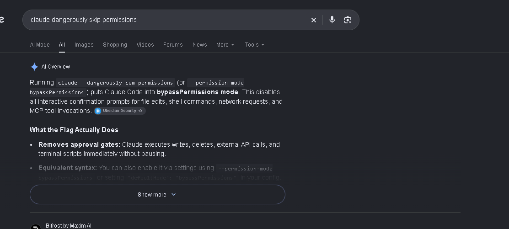

# Claude Cum

**The Claude command Google invented, made real.**


I was trying to look up one normal Claude Code flag. Google’s AI Overview looked me straight in the face and recommended this:

```text
claude --dangerously-cum-permissions
```

I checked. That's not a command. Google had apparently launched a feature before Anthropic did, and given it the worst possible name.

So here it is: **Claude Cum**, a tiny, unofficial launcher that turns Google's accidental product announcement into a command you can actually run.



## The feature

Install it from this GitHub repo:

```bash
npm install -g github:jfudge-ai/claude-cum
```

Then run:

```bash
claude-cum
```

It tells you what it's about, asks for confirmation, then starts your installed Claude Code with the **real** flag, `--dangerously-skip-permissions`. Pass normal Claude arguments after the command:

```bash
claude-cum --print "hello"
claude-cum --dry-run --print "hello"
claude-cum --yes --print "hello"
```

You need Node.js 18+ and [Claude Code](https://docs.anthropic.com/en/docs/claude-code/overview) installed separately. `--yes` skips this launcher's confirmation; Claude's own permission prompts are skipped by the real flag. Use it only where you're comfortable giving Claude that access.

## Patch notes

- Google AI Overview invented `--dangerously-cum-permissions`.
- Anthropic did not.
- This launcher makes the joke executable by mapping it to the real flag.
- Version 0.1.0: consent added back to the permission-skipping command.

This is a parody project, not an Anthropic product or an official Claude feature. Google's invented flag still does not exist in Claude Code. The [actual CLI reference](https://docs.anthropic.com/en/docs/claude-code/cli-usage) spells it `--dangerously-skip-permissions`.
